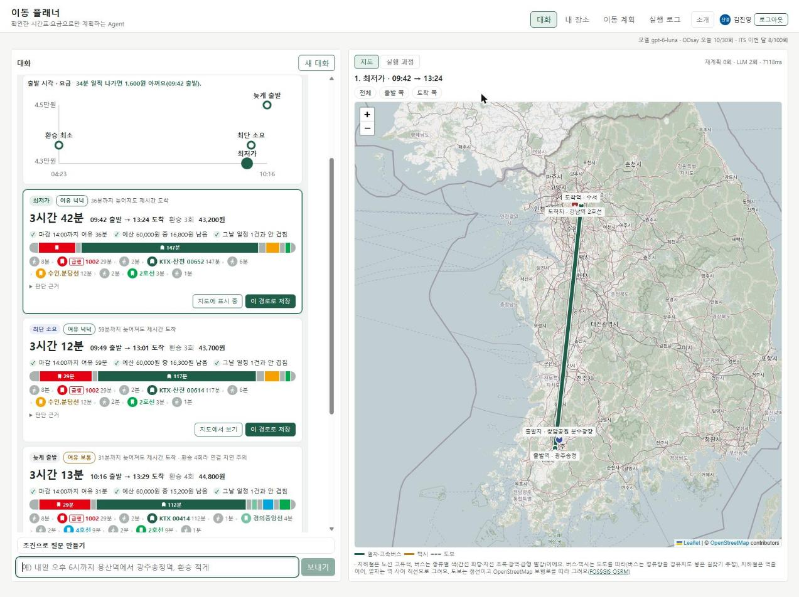
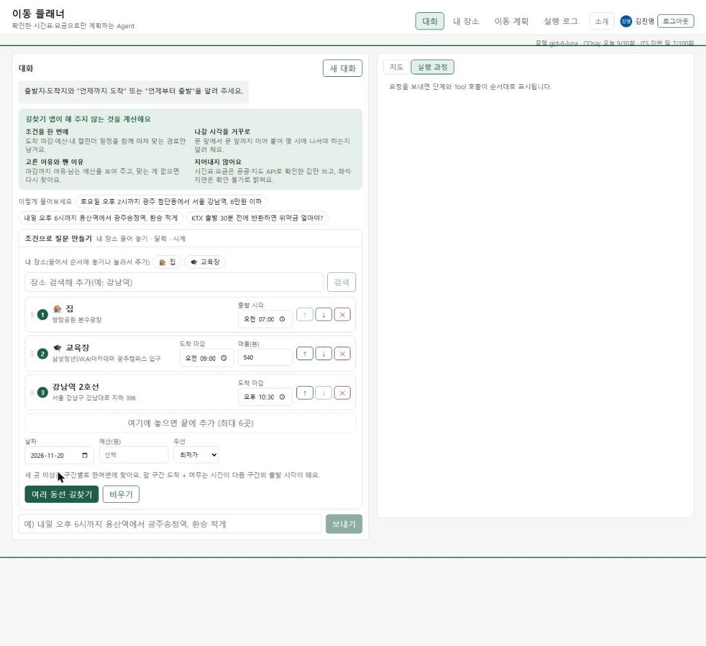
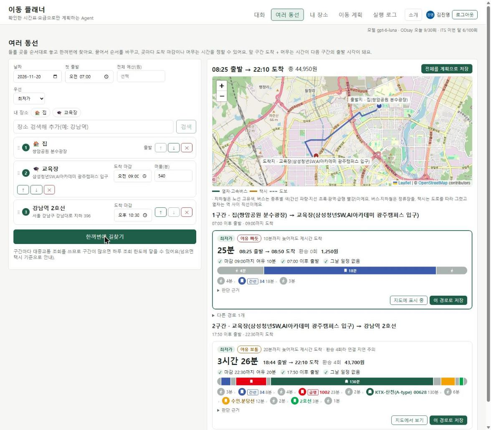
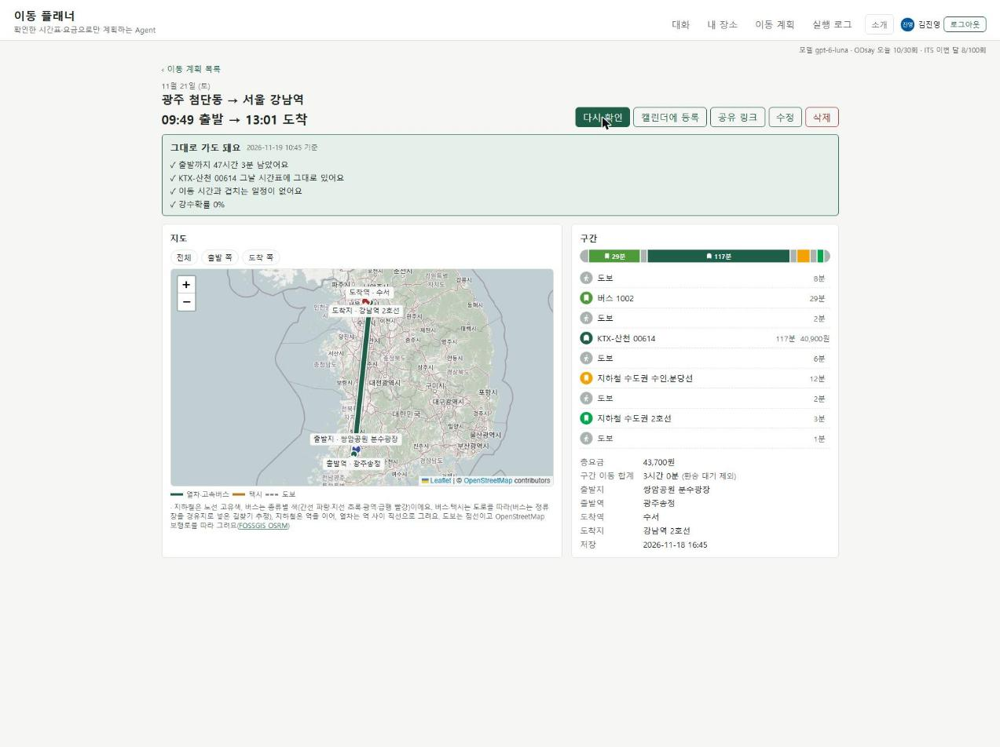
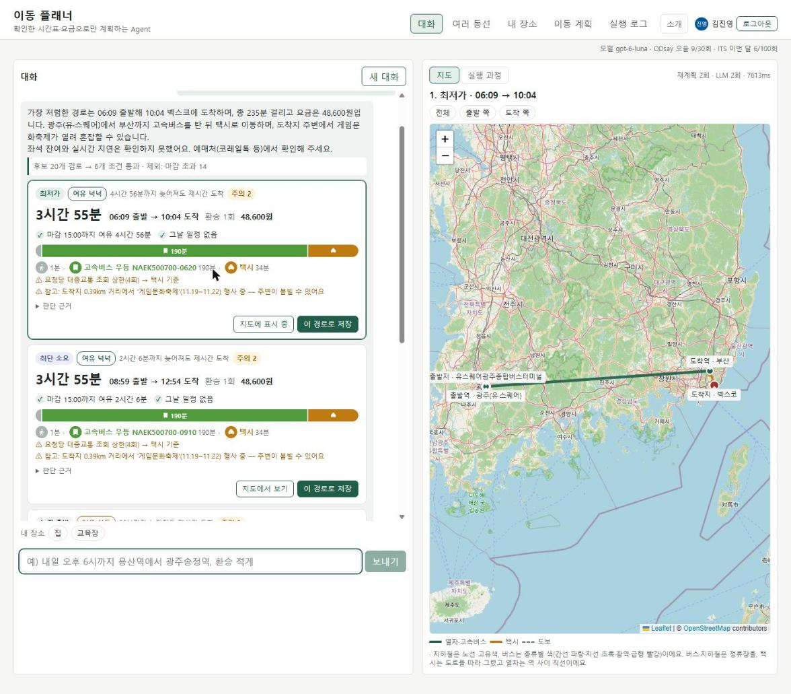
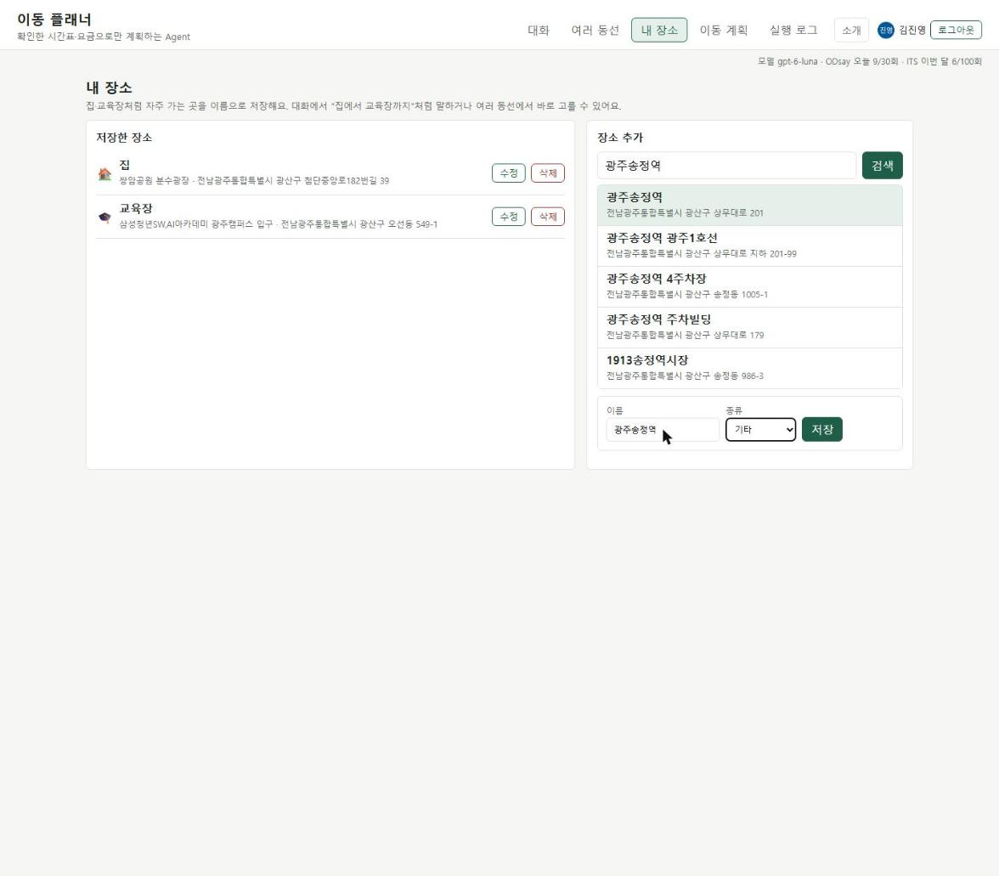
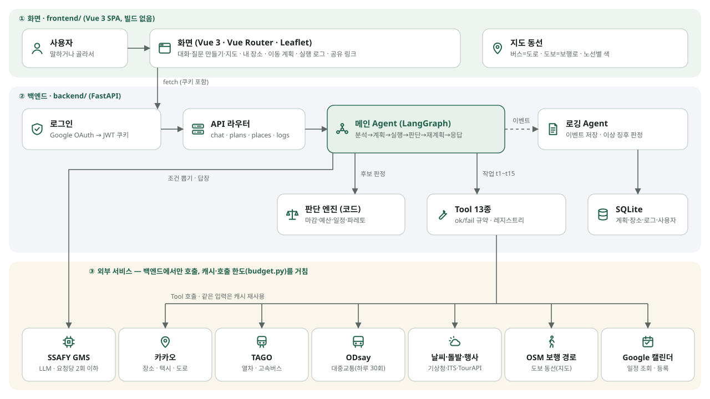
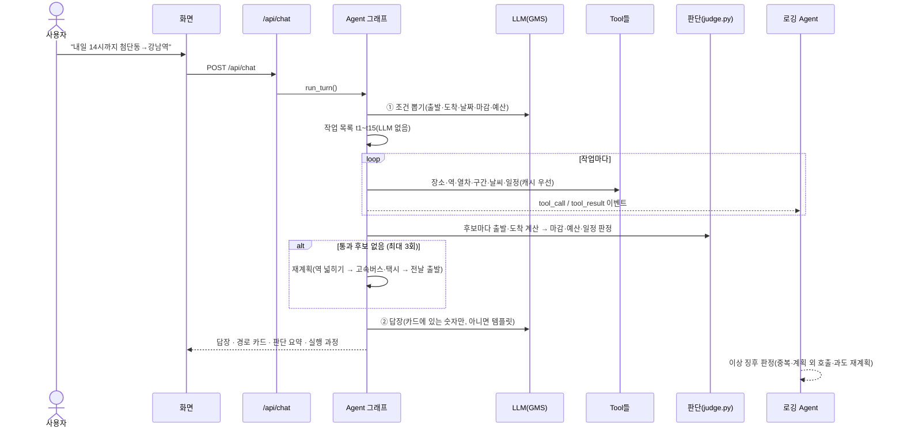
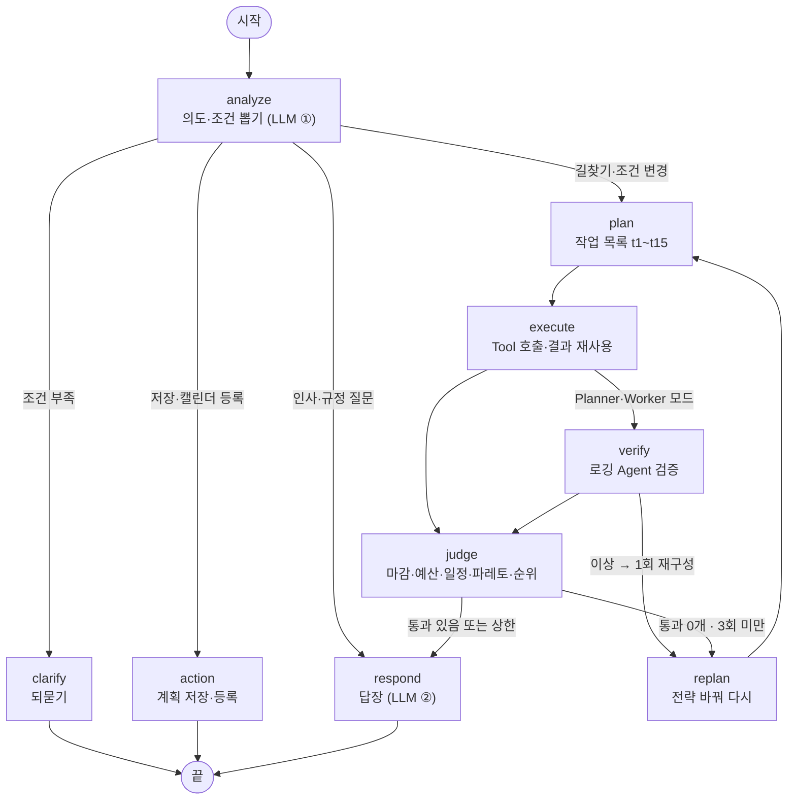
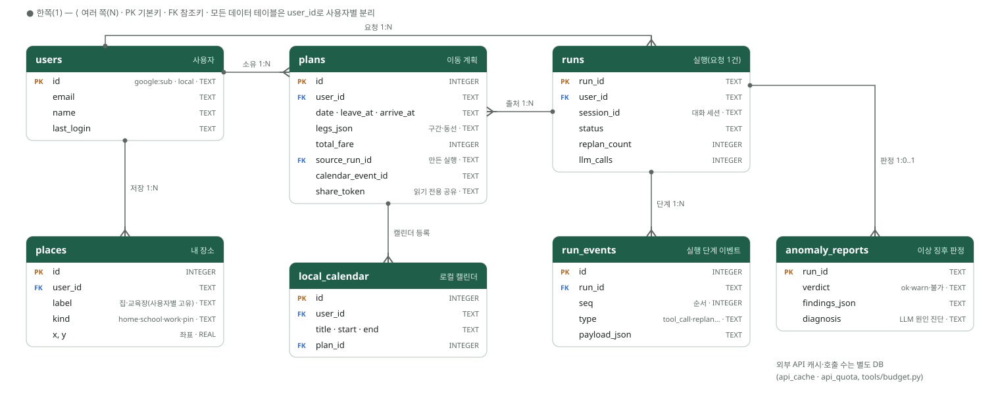

# 이동 플래너 (Route Planner)

> AI 코어 프로젝트 3회차 · Agent 기반 도메인 플래너 · 광주 3반

**약속 시각에서 거꾸로 계산하는 문 앞~문 앞 이동 플래너.** "내일 오후 2시까지 첨단동에서 강남역, 6만원 이하"라고 말하면 Agent가 장소·역·열차·버스·택시·날씨·내 캘린더를 외부 API로 확인하고, 마감·예산·일정을 코드로 판정해 **몇 시에 나가면 되는지**를 근거와 함께 제안합니다.


## 프로젝트 소개

| 문제 | 해결 |
|---|---|
| 지도 앱은 "지금 출발하면"만 알려 준다. 도착 마감·예산·내 일정을 함께 따지려면 사람이 여러 앱을 오가며 계산한다 | 조건을 한 번에 받아 **도착 마감에서 거꾸로** 출발 시각을 계산하고, 예산·캘린더와 맞는 경로만 남긴다 |
| LLM에게 바로 물으면 시간표·요금을 지어낸다 | LLM은 **조건 뽑기와 답장 문장에만**(요청당 최대 2회). 숫자는 전부 외부 API 값과 코드 계산이고, 답장 숫자가 카드에 없으면 거절한다 |
| 조건에 맞는 경로가 없으면 그냥 "없음" | 역 넓히기 → 고속버스·택시 → 전날 출발 순으로 **재계획**(상한 3회), 그래도 없으면 뺀 이유와 함께 조건 조정을 묻는다 |

| 대화 · 경로 카드 · 지도 | 시간·요금 트레이드오프 | 질문 만들기(끌어 놓기) |
|---|---|---|
|  |  |  |

<details>
<summary>화면 더 보기 (여러 동선 · 다시 확인 · 행사 안내 · 계획 · 실행 로그 · 내 장소)</summary>

| 여러 동선 | 저장한 계획 다시 확인 | 고속버스·행사 안내 |
|---|---|---|
|  |  |  |

| 계획 상세 | 이동 계획 목록 | 실행 로그·이상 징후 | 내 장소 |
|---|---|---|---|
|  |  |  |  |
</details>

## 기술 스택

| 영역 | 사용 기술 |
|---|---|
| Backend |     |
| Agent · AI |   -412991?style=for-the-badge&logo=openai&logoColor=white)  |
| Frontend |     |
| 인증 · 연동 |    |
| 외부 데이터 |     |
| 테스트 |   |

버전: FastAPI 0.141 · LangGraph 1.2 · LangChain 1.3 · Pydantic 2.13 · Chroma 1.5 · Vue 3.5 · Vue Router 4.5 · Leaflet 1.9 (프론트는 빌드 없이 CDN, 버전·무결성 해시 고정)

## 시스템 아키텍처



- **화면과 서버 분리**: 화면은 정적 파일(Vue 3), 서버는 FastAPI. 요청마다 로그인 쿠키(JWT)로 사용자를 정하고, 모든 데이터는 사용자별로 나뉜다.
- **Agent 안의 역할 분리**: LLM은 말 이해와 답장, **판단은 코드**(`agent/judge.py`), 외부 호출은 **Tool**(`tools/`)만 한다. 모든 단계는 이벤트로 남고 로깅 Agent가 저장·이상 징후를 판정한다.
- **외부 API 보호**: 모든 외부 호출은 `tools/budget.py`를 지나 캐시를 먼저 보고, 하루·월 한도를 넘지 않게 센다(ODsay 하루 30회, ITS 월 100회).

<details>
<summary>요청 하나가 처리되는 순서</summary>


</details>

<details>
<summary>Agent 그래프 (backend/agent/graph.py)</summary>


</details>

## 기능

### 필수 기능 (F3001 ~ F3019)
| 구분 | 내용 |
|---|---|
| Tool (F3001~F3004) | 공통 `ok/fail` 규약·"언제 쓰는지" 설명·JSON Schema 입력. 열차(TAGO)·대중교통(ODsay)·택시(카카오 모빌리티)·장소·역(카카오 로컬)·날씨(기상청)·도로 돌발(ITS)·고속버스(TAGO) 등 13종 — [Tool 정의서](docs/Tool정의서.md) |
| 메인 Agent (F3005~F3011) | LangGraph 분석 → 계획 → 실행 → 판단 → (재계획) → 응답. 마감·출발 하한·예산·캘린더 판단, 재계획 3단계(상한 3), 대화 맥락 유지(후속 요청은 바뀐 조건만) |
| 로깅 (F3012~F3014) | 단계마다 이벤트 발행 → 로깅 Agent(LLM 없음)가 세션 단위로 SQLite 저장, 목록·상세·삭제(수정 없음) |
| 계획 관리 (F3015~F3016) | 저장(같은 날 겹침 알림)·조회·수정·삭제 |
| 서버·화면 (F3017~F3019) | FastAPI(대화·계획·로그 API 분리) + Vue 화면(주소별 페이지, 경로 지도, 실행 과정 타임라인, 키 누락·호출 한도 표시) — [API 명세서](docs/API명세서.md) |

### 심화 기능 (F3020 ~ F3023) — 4종 모두 적용
| 기능 | 적용 내용 |
|---|---|
| F3020 이상 징후 판정 | 규칙으로 중복 호출·계획 외 호출·과도 재계획 판정, 근거 없으면 "판정 불가", 이상 실행만 LLM 원인 진단. 이 판정으로 실제 중복 호출 버그를 찾아 고침 |
| F3021 Planner·Worker | `AGENT_MODE=planner_worker` — 고칠 인자가 있는 실패에서만 Worker LLM, 로깅 Agent 검증 후 재구성. 단일 모드와 비교: [비교결과](docs/비교결과.md) |
| F3022 RAG | 코레일 여객운송약관·고속버스 취소수수료 공지를 Chroma에 색인, 근거 문단·출처 제시 |
| F3023 캘린더 | 로컬 구현 → Google Calendar 교체, 일정을 판단에 반영, 등록은 계획 ID만 |

### 추가 기능
- **질문 만들기** — 내 장소를 끌어 놓고 날짜·시각(숫자 입력)만 고르면 질문 생성. 세 곳 이상이면 여러 동선(구간 연결) 계산
- **시간·요금 그래프** — "34분 일찍 나가면 1,600원 아껴요"처럼 트레이드오프를 한 줄로
- **다시 확인** — 저장한 계획을 출발 전에 다시 판정(열차가 시간표에 남았는지·새 일정·비·행사), 문제 있으면 같은 조건으로 재검색
- **일정으로 경로 제안 · 출발 알림** — 장소 있는 캘린더 일정을 경로 찾기로, 출발 15·5분 전 알림
- **실제 동선 지도** — 버스는 도로, 도보는 보행로를 따라, 노선별 색
- **Google 로그인 · 사용자별 데이터 · 공유 링크** — 읽기 전용 공유, 집 위치는 흐리게
- **행사 혼잡 안내** — 도착지 1km 안 그날 축제·행사(TourAPI)

## 설계 포인트

| 고민 | 선택 |
|---|---|
| LLM이 숫자를 지어내지 않게 | LLM 호출을 요청당 2회(조건·답장)로 고정, 시각·요금 판단은 코드. 답장 숫자가 카드에 없으면 템플릿으로 대체(`graph.py` `numbers_ok`) |
| 조건을 어떻게 판단하나 | 도착 마감에서 거꾸로 출발 시각 계산 → 마감·출발 하한·예산·캘린더 통과 → 다른 후보에 모든 면에서 밀리는 경로 제거(파레토) → 최저가·최단·늦게 출발·환승 최소로 순위, 지각 위험(여유 분) 표시 |
| 결과가 없을 때 | 전략을 바꿔 재계획(상한 3), 같은 Tool·입력은 실행 안에서 재사용해 중복 호출 0 |
| 무료 API 한도 | 영구 캐시 + API별 일·월 카운터, 요청당 상한, 초과 시 택시 기준으로 대체 |
| Agent가 잘 돌았는지 | 모든 단계를 이벤트로 저장하고 규칙으로 이상 징후 판정 → 실제로 중복 호출 버그를 이것으로 발견 |
| 보안 | 키는 `.env`만, 오류 메시지에서 URL·키 제거, 로그인 쿠키 HttpOnly·SameSite, Host 검사, 상태 변경 API는 JSON만(폼 위조 차단), 사용자별 데이터 분리, 공유 링크 무작위 토큰·개인 정보 제외 |
| 검증 | pytest 388개(외부 호출 차단, 실제 응답 샘플로) + 실제 API 시나리오·실사용 점검 — [검증 결과](docs/검증결과.md) |

## ERD



계획·장소·실행 로그·로컬 캘린더는 모두 `user_id`로 사용자별로 나뉩니다. 계획은 그것을 만든 실행(`source_run_id`)을 가리켜, 화면의 계획에서 판단 근거 로그까지 거슬러 올라갈 수 있습니다.

## 확장성

- **Tool 추가가 독립적** — Tool은 파일 하나 + `register()`로 붙고, Agent는 레지스트리에서 꺼내 쓴다. 새 교통수단(예: 항공·자전거)은 Tool과 작업 목록 한 줄을 더하면 기존 판단·재계획을 그대로 쓴다.
- **판단 규칙이 코드 한곳** — 마감 여유·예산·순위·지각 위험이 `judge.py`에 모여 있어 정책(예: 환승 가중치)을 바꿔도 LLM·Tool에 영향이 없다.
- **교체 가능한 구현체** — 캘린더(로컬·Google)·Agent 구조(단일·Planner·Worker)·LLM 모델이 설정 하나로 바뀐다. 다른 캘린더(Outlook 등)는 같은 인터페이스(`calendar/base.py`)만 구현하면 된다.
- **다중 사용자 전제** — 로그인·사용자별 데이터 분리·공유 링크가 이미 있어, SQLite를 PostgreSQL로 바꾸고 서버를 배포하면 여러 명이 쓸 수 있다(저장소 계층 `db/repositories.py`만 교체).
- **화면 확장** — 빌드 없는 Vue 컴포넌트 구조라 페이지·컴포넌트를 파일 단위로 더한다. 순수 계산(질문 문장·그래프·알림)은 분리돼 따로 테스트된다.

확장 절차와 모듈별 수정 위치: [인계 가이드](docs/인계가이드.md)

## 실행 방법

```bash
python -m venv .venv
.venv\Scripts\activate            # macOS/Linux: source .venv/bin/activate
pip install -r requirements.txt
copy .env.example .env            # 키 입력 (아래 'API 키 설정')
python scripts/build_index.py     # 규정 문서 RAG 색인(최초 1회)
uvicorn backend.main:app --port 8000          # 백엔드 → http://127.0.0.1:8000/docs
python scripts/serve_frontend.py 5500        # 프론트 → http://127.0.0.1:5500
```
- 테스트: `pytest` · `node --test tests/frontend/question.test.mjs tests/frontend/tradeoff.test.mjs tests/frontend/reminder.test.mjs`
- 백엔드를 다른 포트로 띄웠다면 `http://127.0.0.1:5500/?api=http://127.0.0.1:8001/api`. 화면은 CDN 라이브러리와 OSM 지도를 쓰므로 인터넷 연결이 필요합니다.
- 로그인 없이 쓰려면 `.env`에 `AUTH_REQUIRED=false`.

## API 키 설정
`.env`(커밋 금지, `.gitignore` 등록). 설정 여부는 `GET /api/config/status`와 화면 상단 배너로 확인(값은 노출하지 않음).

| 변수 | 발급처 |
|---|---|
| `GMS_API_KEY` | SSAFY GMS (모델 `LLM_MODEL=claude-haiku-5-5` — `claude-*`는 GMS Anthropic 경로로 자동 연결, GPT 모델은 `GMS_BASE_URL`. 임베딩 `text-embedding-3-small`) |
| `KAKAO_REST_KEY` | Kakao Developers → 앱 생성 → REST API 키, 제품 설정 > 카카오맵 사용 ON |
| `ODSAY_API_KEY` | ODsay LAB → 애플리케이션 등록(Basic, Server IP 등록) |
| `DATA_GO_KR_KEY` | 공공데이터포털 → TAGO 열차정보·고속버스정보, 기상청 단기예보, 한국관광공사 국문 관광정보(선택) 활용신청 |
| `ITS_API_KEY` | 국가교통정보센터 오픈데이터 → 인증키 발급(돌발상황정보) |
| `CALENDAR_BACKEND=google` | Google Cloud → Calendar API → OAuth 동의 화면(테스트 사용자) → 데스크톱 클라이언트 JSON을 `credentials.json`으로, 첫 실행 때 동의하면 `token.json` 생성. 키 없이 쓰려면 `local` |
| `AUTH_REQUIRED`·`GOOGLE_CLIENT_ID`·`GOOGLE_CLIENT_SECRET`·`GOOGLE_REDIRECT_URI`·`JWT_SECRET` | 로그인(선택). Google 인증 플랫폼 → 웹 애플리케이션 클라이언트, 리디렉션 URI `http://127.0.0.1:8000/api/auth/google/callback`. `JWT_SECRET`은 32자 이상. `CALENDAR_OWNER_EMAIL`: 실제 Google 캘린더를 쓸 계정 |
| `WALK_ROUTE_ENABLED` | 선택(기본 `true`). 도보 구간을 OSM 보행로로 그림. 도보 구간 좌표가 FOSSGIS 서버로 가므로 원치 않으면 `false` |

## 외부 API 출처와 이용 조건
| API | 제공 | 한도·조건 | 이 서비스의 보호 장치 |
|---|---|---|---|
| 카카오 로컬·모빌리티 | Kakao Developers | 무료 쿼터, 운영정책 | 30일·6시간 캐시 |
| TAGO 열차정보·고속버스정보 | 국토교통부(공공데이터포털) | 개발계정 기능별 하루 10,000회 | 1일 캐시 |
| 기상청 단기예보 | 기상청(공공데이터포털) | 개발계정 하루 10,000회 | 발표 시각 단위 캐시 |
| 한국관광공사 TourAPI(행사) | 한국관광공사(공공데이터포털) | 개발계정 트래픽 한도(마이페이지 표시 기준) | 6시간 캐시, 참고 안내만 |
| ODsay 대중교통 길찾기 | ODsay LAB Basic | **하루 30회**, 무료(개인·학생) | 7일 캐시, 하루 24회 + 예약 6회, 요청당 4회 상한, 초과 시 택시 대체 |
| ITS 돌발정보 | 국가교통정보센터 | **월 100회**(개발용) | 실행당 1회·하루 4회 상한, 30분 캐시 |
| SSAFY GMS | SSAFY | 교육용 사용량 한도 | 요청당 LLM 최대 2회 |
| OSM 보행 경로 | FOSSGIS e.V. (`routing.openstreetmap.de`) | 초당 1회 이하·과다 사용 금지·출처 표시, 요청은 서버 로그에 남음 | 서버에서만 호출, 7일 캐시, 1초 간격, 출처 링크, 끄기 스위치 |
| OpenStreetMap 지도 타일 | OpenStreetMap 재단 | ODbL, 타일 이용 정책 | 지도에 출처 표시 |
| 코레일 여객운송약관, 정책브리핑 공지 | 한국철도공사, 국토교통부 | 공개 약관 / 공공누리 제1유형 | `data/docs/SOURCES.md` |

## 산출물
| 산출물 | 위치 |
|---|---|
| 요구사항 정의서 · 기획 검증 | [요구사항정의서](docs/요구사항정의서.md) · [기획검증](docs/기획검증.md) |
| Agent 설계 문서 | [Agent설계](docs/Agent설계.md) |
| Tool 정의서 | [Tool정의서](docs/Tool정의서.md) |
| API 명세서 | [API명세서](docs/API명세서.md) · `docs/openapi.json` |
| 검증 결과 · 실행 로그 샘플 | [검증결과](docs/검증결과.md) · [실행로그샘플](docs/실행로그샘플.md) · `docs/evidence/` |
| 심화 기능 비교 | [비교결과](docs/비교결과.md) |
| 셀프 체크리스트 | 공식 양식 기입본 [셀프체크리스트.xlsx](docs/셀프체크리스트.xlsx) · 근거 정리 [셀프체크리스트.md](docs/셀프체크리스트.md) |
| 인계 가이드 | [인계가이드](docs/인계가이드.md) |

<details>
<summary>폴더 구조</summary>

```
route-planner/
├── backend/
│   ├── main.py · container.py · settings.py · schemas.py · share.py
│   ├── api/routes.py            # HTTP API
│   ├── auth/                    # Google 로그인 → JWT 쿠키 → 현재 사용자
│   ├── agent/                   # 메인 Agent: graph · executor · judge · conditions · ko_time
│   │                            #   service · trip · recheck · suggest · planner_worker · llm · prompts
│   ├── tools/                   # Tool 13종 + base · registry · http · budget(캐시·한도)
│   ├── events/                  # 이벤트 버스 · 로깅 Agent · 이상 징후
│   ├── db/                      # SQLite 스키마 · 저장소
│   └── calendar/                # 캘린더 구현체(local · google)
├── frontend/
│   ├── index.html · css/app.css
│   └── js/  main · api · store · format · question · tradeoff · reminder
│       ├── components/          # RouteMap · common · PlanBuilder · TradeoffChart · TripResult 등
│       └── pages/               # Chat · Places · Plans · PlanDetail · Logs · SharedPlan
├── scripts/                     # serve_frontend · build_index · field_check · compare_modes · make_readme_images 등
├── tests/                       # pytest(외부 호출 차단) · tests/frontend(node --test)
├── data/docs/                   # RAG 원문 · 출처
└── docs/                        # 산출물 · 증거 · 스크린샷 · images
```
</details>
