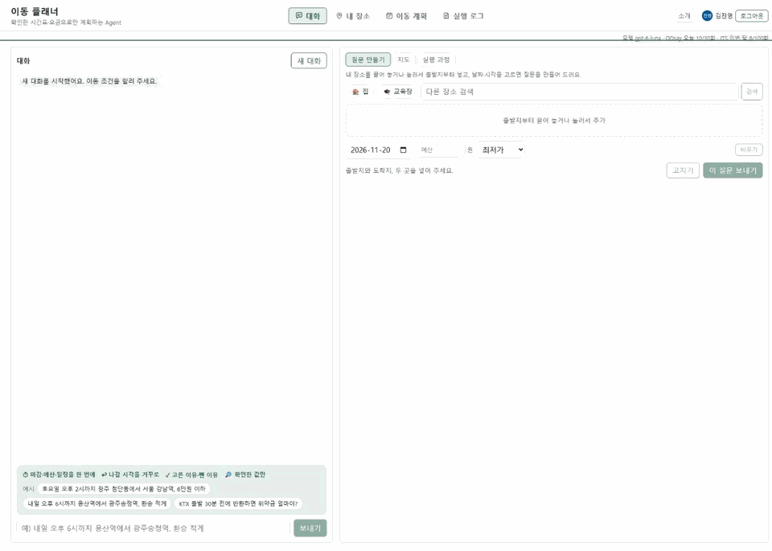
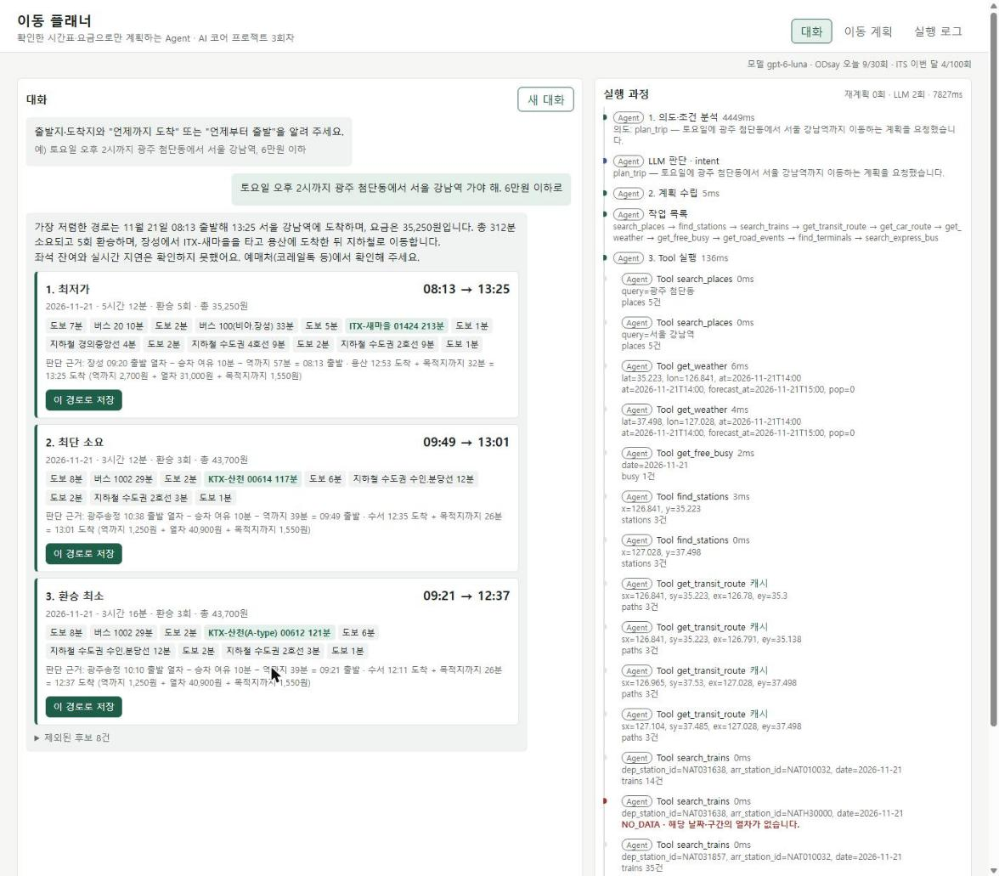
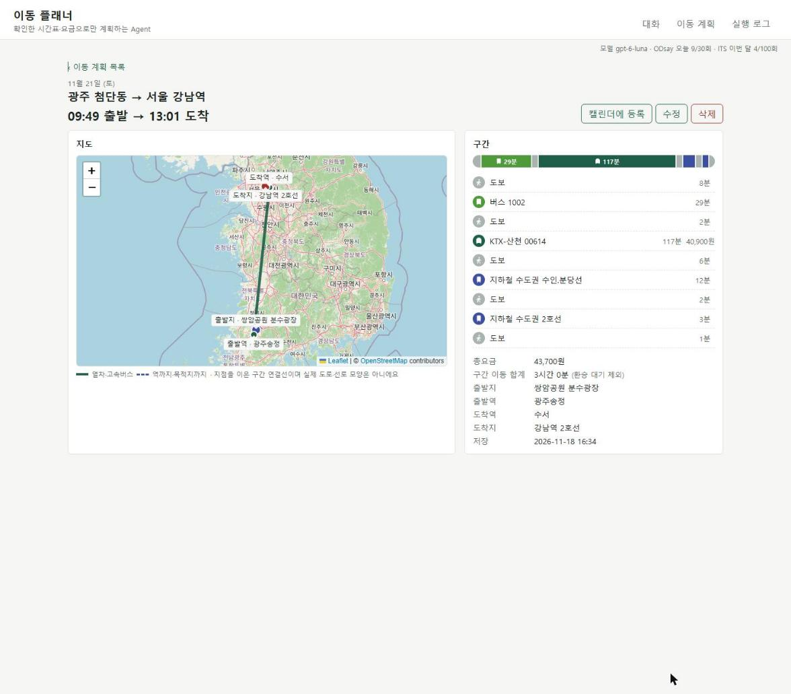
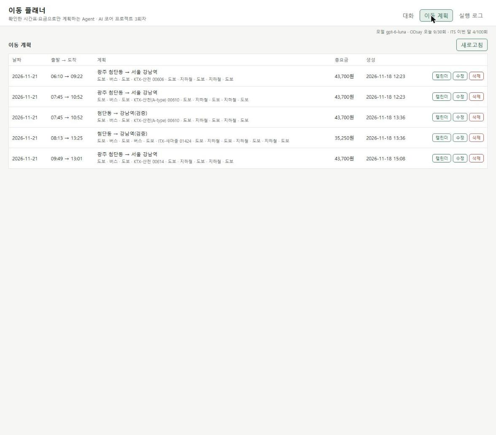
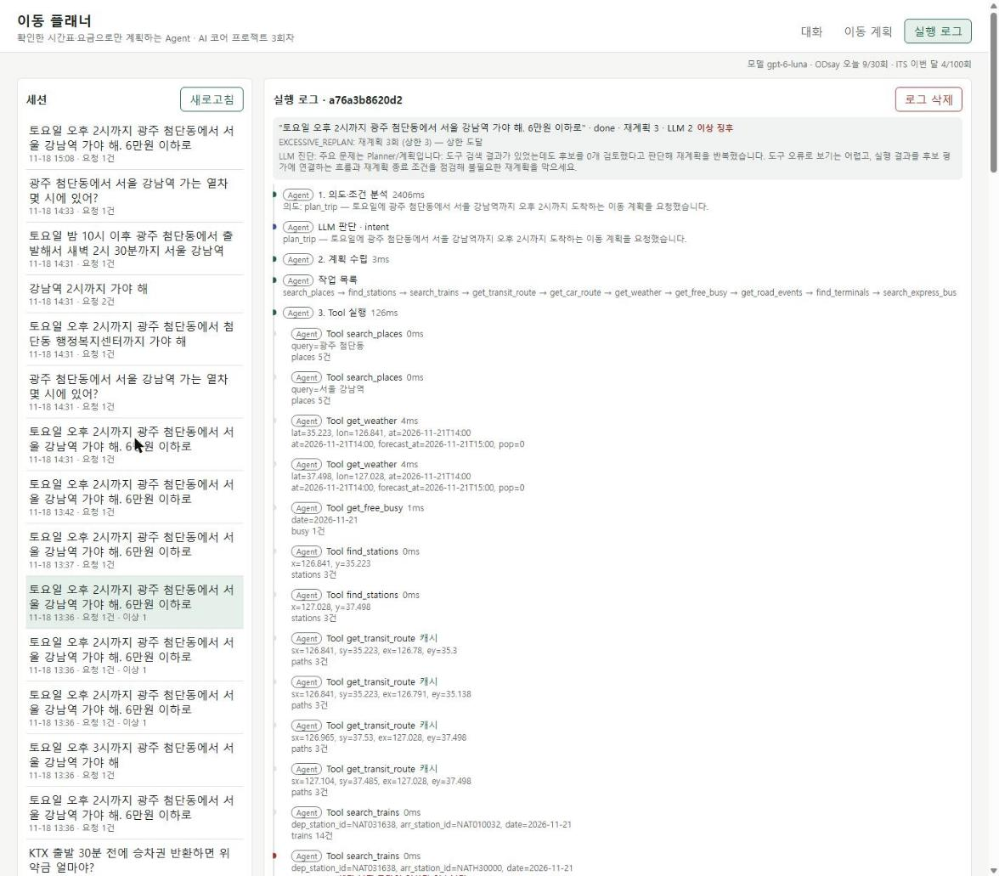

# 이동 플래너 (Route Planner)

> AI 코어 프로젝트 3회차 — Agent 기반 도메인 플래너 서비스 · 광주 3반

"어디서 → 어디로, 언제까지(또는 언제부터), 얼마 이하로" 가는지 말하면, Agent가 **외부 API로 확인한 시간표·소요시간·요금만으로** 도보·지하철·버스·열차·택시를 이어 붙인 문 앞~문 앞 이동 옵션을 계산해 근거와 함께 제안하고, 고른 옵션을 이동 계획으로 저장·캘린더 등록까지 해 줍니다. 좌석·실시간 지연처럼 확인할 수 없는 값은 지어내지 않고 "확인 불가"로 밝힙니다.



| 대화 + 경로 지도 | 계획 상세(지도·구간) | 이동 계획 목록 | 실행 로그·이상 징후 |
|---|---|---|---|
|  |  |  |  |

## 1. 실행 방법

```bash
python -m venv .venv
.venv\Scripts\activate            # macOS/Linux: source .venv/bin/activate
pip install -r requirements.txt
copy .env.example .env            # 키 입력 (아래 3장)
python scripts/build_index.py     # 규정 문서 RAG 색인(최초 1회)
uvicorn backend.main:app --port 8000          # 백엔드 → http://127.0.0.1:8000/docs
python scripts/serve_frontend.py 5500        # 프론트 → http://127.0.0.1:5500
```
- 백엔드를 다른 포트로 띄웠다면 `http://127.0.0.1:5500/?api=http://127.0.0.1:8001/api` 처럼 지정합니다.
- 화면은 빌드 없이 CDN의 Vue 3·Vue Router·Leaflet(버전 고정·무결성 해시)과 OpenStreetMap 지도 타일을 불러오므로 **인터넷 연결이 필요**합니다. `python -m http.server`는 Windows에서 `.js`를 `text/plain`으로 보내 화면이 뜨지 않을 수 있어 `serve_frontend.py`를 씁니다.
- 테스트: `pytest` (253개, 외부 API를 부르지 않음)
- 확인용 스크립트: `scripts/tools_demo.py`·`scripts/tools_demo_extra.py`(Tool 단독, 12종), `scripts/smoke_run.py`(대화 1턴), `scripts/run_scenarios.py`(대표 시나리오), `scripts/compare_modes.py`(구조 비교)

## 2. 기능

### 필수 (F3001~F3019)
| 기능 | 내용 |
|---|---|
| Tool 정의·등록 | 공통 `ok/fail` 규약, "언제 쓰는지" 설명, JSON Schema 입력, 외부 API 툴/로컬 서버 API 툴 구분 (`docs/Tool정의서.md`) |
| 후보·상세·보조 Tool | 열차 시간표·운임(TAGO), 역↔장소 대중교통(ODsay)·택시(카카오 모빌리티), 장소·역(카카오 로컬), 날씨(기상청), 도로 돌발(ITS), 고속버스(TAGO) |
| 메인 Agent(LangGraph) | 분석 → 계획 → 실행 → 판단 → (재계획) → 응답. 제약 계산(마감·출발 하한·예산·캘린더), 재계획 3단계(거점 확장·수단 확장·전날 출발, 상한 3), 대화 맥락 유지 |
| 로깅 | 실행 이벤트 발행 ↔ 로깅 Agent(LLM 없음)가 세션 단위로 SQLite 저장, 목록·상세·삭제(수정 없음) |
| 계획 관리 | 저장(같은 날 겹침 알림)·조회·수정·삭제 |
| 서버·화면 | FastAPI(`docs/API명세서.md`), Vue 화면 — 주소별 페이지(대화 `#/`, 이동 계획 `#/plans`, 계획 상세 `#/plans/:id`, 실행 로그 `#/logs`, 세션 상세 `#/logs/:sid`), 경로 지도(출발지·역·도착지), 경로 카드(소요 시간·수단별 색 막대·수단 아이콘 줄·판단 결과 "마감까지 여유/예산 남은 금액/일정 안 겹침"), 판단 요약(검토·통과·제외 사유별 개수), 첫 화면 서비스 소개, 실행 단계·Tool 이력·재계획 구분·처리 중(경과 초)·키 누락·호출 한도 표시, 예시 질문, 저장 알림에서 상세로 이동, 계획 검색·기간 필터, 이상 징후 세션 필터 |

### 심화 (F3020~F3023) — 4종 모두 적용
| 기능 | 내용 |
|---|---|
| F3020 이상 징후 판정 | 규칙으로 중복 호출·계획 외 호출·과도 재계획 판정, 근거 없으면 "판정 불가", 이상 실행만 LLM 원인 진단(분리 저장). 이 판정으로 실제 중복 호출 버그를 찾아 고침 |
| F3021 Planner·Worker | `AGENT_MODE=planner_worker` — 고정 인자 보호, 고칠 인자가 있는 실패에서만 Worker LLM, 로깅 Agent 검증 후 재구성. 비교: `docs/비교결과.md` |
| F3022 RAG | 코레일 여객운송약관·고속버스 취소수수료 공지를 Chroma에 색인, 근거 문단·출처 제시, 색인 없으면 `NO_INDEX` |
| F3023 캘린더 | 로컬 구현 → Google Calendar(OAuth) 교체, 일정 조회를 판단에 반영, 등록은 계획 ID만 |

## 3. API 키 설정
`.env`(커밋 금지, `.gitignore` 등록)

| 변수 | 발급처 |
|---|---|
| `GMS_API_KEY` | SSAFY GMS (모델 `LLM_MODEL=gpt-6-luna`, 임베딩 `text-embedding-3-small`) |
| `KAKAO_REST_KEY` | Kakao Developers → 앱 생성 → 플랫폼 키의 REST API 키, 제품 설정 > 카카오맵 사용 ON |
| `ODSAY_API_KEY` | ODsay LAB → 애플리케이션 등록(Basic, Server IP 등록) |
| `DATA_GO_KR_KEY` | 공공데이터포털 → TAGO 열차정보·고속버스정보, 기상청 단기예보 활용신청(일반 인증키) |
| `ITS_API_KEY` | 국가교통정보센터 오픈데이터 → 인증키 발급(돌발상황정보) |
| `CALENDAR_BACKEND=google` | Google Cloud → Calendar API 사용 → OAuth 동의 화면(외부·테스트 사용자 등록) → 데스크톱 OAuth 클라이언트 JSON을 `credentials.json`으로 저장, 최초 실행 시 브라우저 동의 후 `token.json` 생성. 키 없이 쓰려면 `local` |

설정 여부는 `GET /api/config/status`와 화면 상단 배너로 확인(값은 노출하지 않음).

## 4. 외부 API 출처와 이용 조건 (NF3007)
| API | 제공 | 한도·조건 | 이 서비스의 보호 장치 |
|---|---|---|---|
| 카카오 로컬·모빌리티 | Kakao Developers | 무료 쿼터, 운영정책 | 30일·6시간 캐시 |
| TAGO 열차정보·고속버스정보 | 국토교통부(공공데이터포털) | 개발계정 기능별 하루 10,000회, 이용허락범위 제한 없음 | 1일 캐시 |
| 기상청 단기예보 | 기상청(공공데이터포털) | 개발계정 하루 10,000회 | 발표 시각 단위 캐시 |
| ODsay 대중교통 길찾기 | ODsay LAB Basic | **하루 30회**, 무료(개인·학생) | 7일 캐시, 하루 24회 + 예약 6회, 요청당 4회 상한, 초과 시 택시 대체 |
| ITS 돌발정보 | 국가교통정보센터 | **월 100회**(개발용) | 실행당 1회·하루 4회 상한, 30분 캐시 |
| SSAFY GMS | SSAFY | 교육용 사용량 한도 | 요청당 LLM 최대 2회 |
| OpenStreetMap 지도 타일 | OpenStreetMap 재단 | ODbL, 타일 이용 정책(가벼운 사용·출처 표시) | 지도에 출처 표시, 경로 화면에서만 사용 |
| 코레일 여객운송약관, 정책브리핑 공지 | 한국철도공사, 국토교통부 | 공개 약관 / 공공누리 제1유형 | `data/docs/SOURCES.md` |

## 5. 문서
| 산출물 | 위치 |
|---|---|
| 요구사항 정의서 | `docs/요구사항정의서.md` |
| 기획 검증 | `docs/기획검증.md` |
| Agent 설계 | `docs/Agent설계.md` |
| Tool 정의서 | `docs/Tool정의서.md` |
| API 명세서 | `docs/API명세서.md` (`docs/openapi.json`) |
| 검증 결과 | `docs/검증결과.md`, `docs/evidence/` |
| 실행 로그 샘플 | `docs/실행로그샘플.md` |
| 구조 비교 | `docs/비교결과.md` |
| 셀프 체크리스트 | `docs/셀프체크리스트.md` |
| 설계·구현 계획 | `docs/superpowers/specs/`, `docs/superpowers/plans/` |

## 6. 구조
```
route-planner/
├── backend/                     # FastAPI 백엔드
│   ├── main.py                  # 앱 생성·CORS·오류 숨김
│   ├── container.py             # 의존성 조립
│   ├── settings.py              # .env 설정
│   ├── schemas.py               # 요청·응답 형식(Pydantic)
│   ├── api/
│   │   └── routes.py            # 대화·계획·실행 로그·메타 API
│   ├── agent/                   # 메인 Agent(LangGraph)
│   │   ├── graph.py             # 분석→계획→실행→판단→(재계획)→응답 그래프
│   │   ├── executor.py          # 작업 목록 실행·Tool 호출·결과 재사용
│   │   ├── judge.py             # 출발·도착 시각 계산, 마감·예산·일정 판단
│   │   ├── conditions.py        # 요청 조건·후속 요청 병합
│   │   ├── ko_time.py           # 한국어 날짜·시각 보조 파서
│   │   ├── planner_worker.py    # 심화: Planner·Worker
│   │   ├── llm.py               # GMS LLM 호출
│   │   ├── prompts.py
│   │   ├── service.py           # 대화 1턴 실행
│   │   └── state.py
│   ├── tools/                   # Tool (공통 ok/fail 규약)
│   │   ├── base.py · registry.py · http.py · budget.py · catalog_all.py
│   │   ├── kakao_local.py       # 장소 검색
│   │   ├── stations.py          # 근처 기차역
│   │   ├── tago_train.py        # 열차 시간표·운임
│   │   ├── tago_bus.py          # 고속버스 터미널·시간표
│   │   ├── odsay.py             # 대중교통 구간
│   │   ├── kakao_mobility.py    # 택시 구간
│   │   ├── kma_weather.py       # 날씨
│   │   ├── its_events.py        # 도로 돌발정보
│   │   ├── rag.py               # 심화: 규정 검색(RAG)
│   │   └── calendar_tools.py    # 심화: 캘린더 조회·등록
│   ├── events/                  # 이벤트 발행·로깅 Agent·이상 징후
│   │   ├── bus.py
│   │   ├── logger_agent.py
│   │   └── anomaly.py
│   ├── db/                      # SQLite 저장소
│   │   ├── database.py
│   │   └── repositories.py
│   └── calendar/                # 캘린더 구현체
│       ├── base.py
│       ├── local.py
│       └── google.py
├── frontend/                    # Vue 3 화면(빌드 없음, CDN + 주소별 페이지)
│   ├── index.html               # 라이브러리 로드(버전 고정·무결성 해시)
│   ├── css/app.css
│   └── js/
│       ├── main.js              # 라우터·상단바·알림
│       ├── api.js · store.js · format.js
│       ├── components/
│       │   ├── RouteMap.js      # 경로 지도(Leaflet + OpenStreetMap)
│       │   ├── ModeIcon.js      # 이동 수단 아이콘(직접 그린 SVG)
│       │   └── common.js        # 경로 카드·수단 막대·아이콘 줄·실행 과정 타임라인
│       └── pages/
│           ├── ChatPage.js      # 대화 + 지도 + 실행 과정
│           ├── PlansPage.js     # 이동 계획 목록(검색·기간 필터)
│           ├── PlanDetailPage.js# 계획 상세(지도·구간·캘린더·수정·삭제)
│           └── LogsPage.js      # 실행 로그 목록·세션 상세
├── scripts/                     # 확인용 스크립트
│   ├── serve_frontend.py        # 프론트 정적 서버
│   ├── check_apis.py · tools_demo.py · tools_demo_extra.py
│   ├── smoke_run.py · run_scenarios.py · compare_modes.py
│   └── build_index.py           # 규정 문서 색인
├── data/docs/                   # 규정 원문(색인 대상)
├── tests/                       # pytest (fixtures = 실제 응답 샘플)
└── docs/                        # 산출물 문서·증거·스크린샷
```
